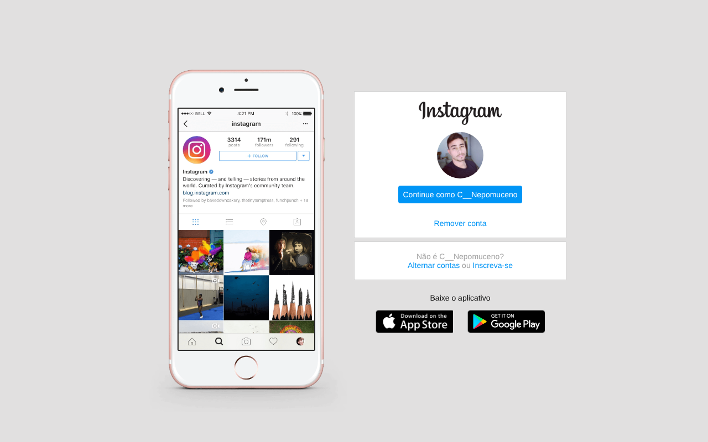

# Clone da tela de login do Instagram (Flexbox)

Recriação da tela "Continuar como..." do Instagram Web usando apenas **HTML e CSS com Flexbox**, feita durante a aula de Flexbox da [DIO](https://www.dio.me/) em 2022.

> Parte da minha trilha de estudos — [github.com/CaioNepomuceno2](https://github.com/CaioNepomuceno2)



## O que foi praticado

- Layout com **Flexbox**: `display: flex`, `flex-direction`, `align-items` e `justify-content` para centralizar e alinhar os blocos.
- Estrutura em grupos (imagem do celular à esquerda e cartão de login à direita).
- Botões das lojas de aplicativo feitos com `background-image` e o seletor `:nth-child`.
- **Responsividade com media queries:**
  - até 1024px o conteúdo ocupa 90% da largura;
  - até 650px a imagem do celular é ocultada e o cartão ocupa toda a largura, com fundo branco (visual de celular).
- Reset de CSS com `box-sizing: border-box`.

## Como abrir

Não há dependências nem build. Basta abrir o `index.html` no navegador, ou servir a pasta localmente:

```bash
git clone https://github.com/CaioNepomuceno2/estudo-clone-instagram.git
cd estudo-clone-instagram
python -m http.server 8000   # acesse http://localhost:8000
```

Por ser uma página estática, também pode ser publicada no **GitHub Pages** (Settings → Pages → *Deploy from a branch* → `main` / raiz).

## Estrutura

```
estudo-clone-instagram/
├── index.html      # marcação da página
├── style.css       # estilos e media queries
├── img/            # imagem do celular, logo, foto de perfil e botões das lojas
└── docs/
    └── screenshot.png
```

## Observação

Projeto apenas de estudo de HTML/CSS: os links e botões não têm funcionalidade e não há nenhum vínculo com o Instagram ou a Meta. As marcas e logotipos pertencem aos seus respectivos donos.
